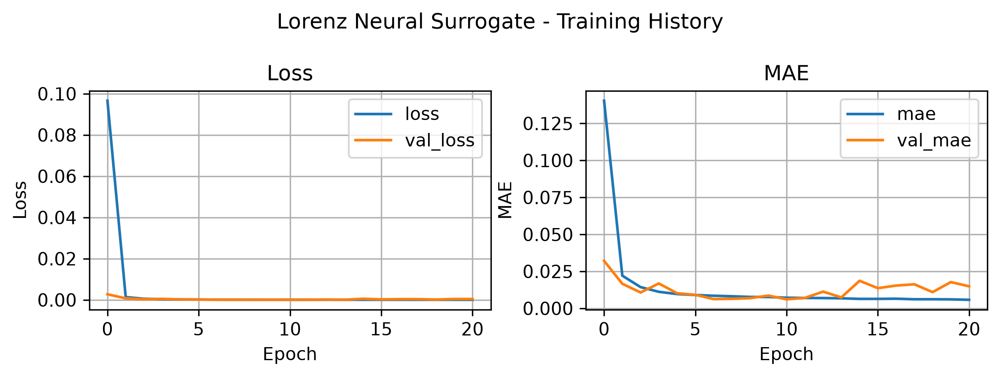
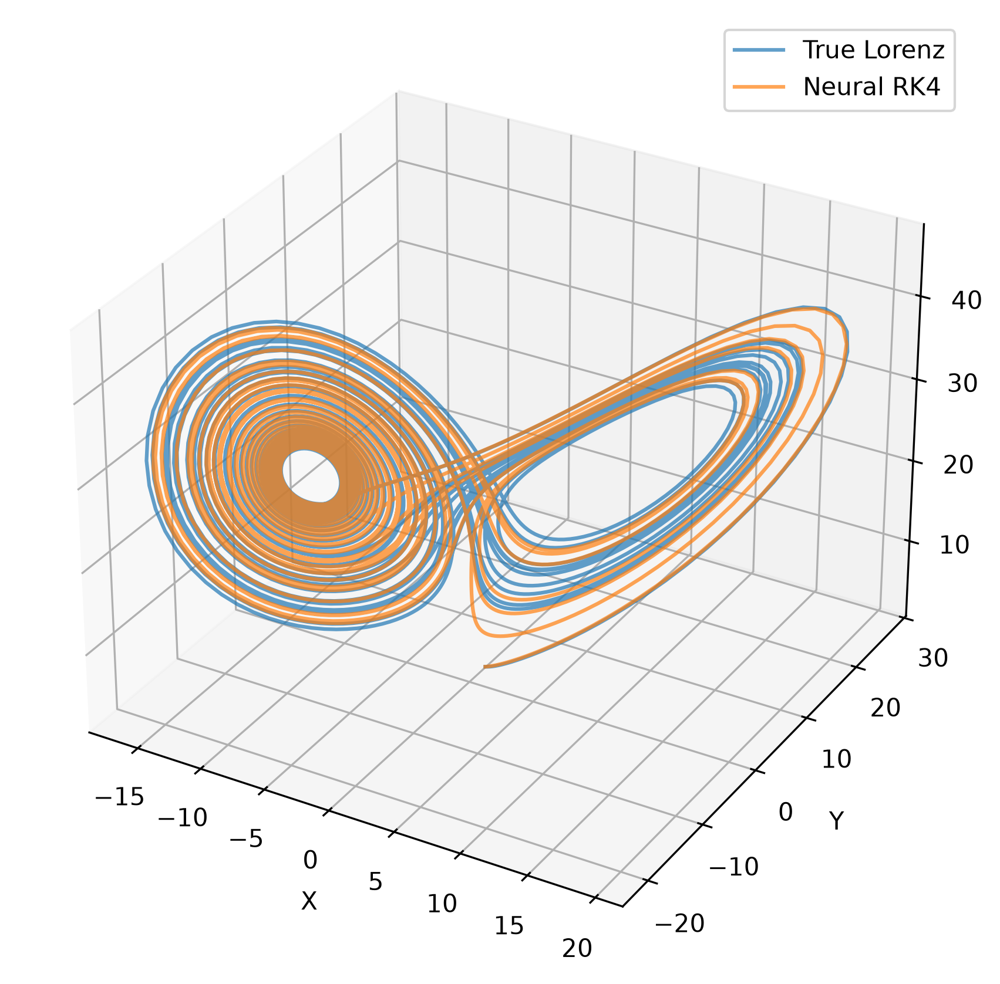
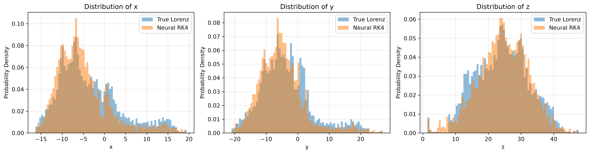

# Neural Surrogate Modeling of the Lorenz System

**A data-driven neural surrogate model for learning the vector field and reproducing the chaotic dynamics of the Lorenz-63 system.**

## Overview

This project investigates the use of a neural network to approximate the vector field of the Lorenz-63 system.

A multilayer perceptron (MLP) is trained to predict the time derivatives of the system variables from their current states. The learned vector field is subsequently integrated using a fourth-order Runge–Kutta (RK4) method to generate autonomous trajectories.

The main objective is to evaluate whether a neural surrogate can reproduce important geometric, statistical, and dynamical properties of the original chaotic system.

## 1. The Lorenz System

The Lorenz-63 system is defined by:

$$
\frac{dx}{dt}=\sigma(y-x)
$$

$$
\frac{dy}{dt}=x(\rho-z)-y
$$

$$
\frac{dz}{dt}=xy-\beta z
$$

The parameters used in this project are:

| Parameter | Value |
|---|---:|
| $\sigma$ | 10 |
| $\rho$ | 28 |
| $\beta$ | $8/3$ |
| Time step | 0.01 |
| Integration steps | 10,000 |
| Number of trajectories | 30 |

The trajectories are generated using the fourth-order Runge–Kutta (RK4) method, starting from randomly selected initial conditions.

## 2. Dataset Preparation

Thirty trajectories are generated from random initial conditions sampled uniformly from the interval $[0.5,2.0]$ for each state variable.

The dataset is divided by trajectory:

- Training: 20 trajectories
- Validation: 4 trajectories
- Testing: 6 trajectories

The network inputs are the system states:

$$
\mathbf{x}=(x,y,z)
$$

The targets are the corresponding derivatives:

$$
\mathbf{f}(\mathbf{x})=(\dot{x},\dot{y},\dot{z})
$$

Input and target variables are standardized using statistics calculated from the training dataset only.

## 3. Neural Network Architecture

A fully connected multilayer perceptron is used to approximate the Lorenz vector field.

| Layer | Configuration |
|---|---|
| Input | 3 neurons |
| Hidden layer 1 | 128 neurons, tanh |
| Hidden layer 2 | 128 neurons, tanh |
| Output | 3 neurons |

Training configuration:

- Optimizer: Adam
- Learning rate: 0.001
- Loss function: Mean Squared Error (MSE)
- Batch size: 256
- Maximum epochs: 100
- Early stopping based on validation loss

## 4. Neural RK4 Integration

After training, the neural network replaces the original Lorenz vector field during autonomous prediction.

The predicted derivatives are integrated using RK4:

$$
\mathbf{x}_{t+\Delta t}
=
\operatorname{RK4}
\left(
\mathbf{x}_t,\mathbf{f}_{\theta}
\right)
$$

where $\mathbf{f}_{\theta}$ represents the learned neural vector field.

This allows the neural model to generate trajectories without evaluating the original Lorenz equations during the prediction stage.

## 5. Evaluation and Dynamical Analysis

The neural surrogate is evaluated through several complementary analyses.

### One-step derivative prediction

Prediction performance is evaluated using:

- Mean Squared Error (MSE)
- Mean Absolute Error (MAE)
- Coefficient of determination ($R^2$)

### Attractor reconstruction

The reconstructed neural trajectories are compared with the original Lorenz attractor in three-dimensional phase space.

### Probability distributions

The probability distributions of $x$, $y$, and $z$ are compared between the reference system and the neural surrogate.

### Autocorrelation functions

Temporal correlations are examined to assess whether the neural model reproduces the temporal structure of the dynamics.

### Lyapunov exponents

The largest Lyapunov exponent is estimated to investigate sensitivity to initial conditions.

A QR-based numerical method is also implemented to estimate the full Lyapunov spectrum.

### Phase-space divergence

The divergence of the learned vector field is calculated using automatic differentiation and compared with the analytical divergence of the original Lorenz system.

For the selected parameters:

$$
\nabla\cdot\mathbf{f}
=-(\sigma+1+\beta)
=-13.6667
$$

## 6. Preliminary Results

The following figures illustrate the training process and the comparison between the original Lorenz system and the neural surrogate.

### Training history



### Lorenz attractor reconstruction



### Probability distributions



## 7. Repository Structure

```text
Lorenz-Neural-Surrogate/
│
├── README.md
├── requirements.txt
├── .gitignore
│
├── notebooks/
│   └── lorenz_neural_surrogate.ipynb
│
└── figures/
    ├── training_history.png
    ├── trajectory.png
    └── lorenz_probability_distributions.png
```

## 8. Installation and Usage

### Requirements

The project uses Python and the libraries listed in `requirements.txt`.

Install the dependencies:

```bash
pip install -r requirements.txt
```

To install Jupyter Notebook if it is not already available:

```bash
pip install notebook
```

### Running the project

Clone the repository:

```bash
git clone https://github.com/azadehmalekan/Lorenz-Neural-Surrogate.git
```

Navigate to the repository:

```bash
cd Lorenz-Neural-Surrogate
```

Launch Jupyter Notebook:

```bash
jupyter notebook notebooks/lorenz_neural_surrogate.ipynb
```

Run all cells to generate the trajectories, train the neural network, and perform the dynamical analyses.

## 9. Methodological Note

The derivative targets in this project are computed from the known analytical Lorenz equations at the generated trajectory points.

Therefore, this work investigates supervised neural approximation of a known dynamical vector field. It does not claim to discover unknown governing equations solely from observational data.

## 10. Future Directions

Potential extensions include:

- Testing generalization across different Lorenz parameters.
- Evaluating longer autonomous rollouts.
- Improving long-term statistical predictions.
- Investigating alternative neural network architectures.
- Applying the methodology to dynamical systems with unknown governing equations.

## Author

**Azadeh Malekan**

Computational Physics | Statistical Physics | Complex Systems | Scientific Machine Learning

ORCID: [0000-0001-7929-1960](https://orcid.org/0000-0001-7929-1960)

GitHub: [azadehmalekan](https://github.com/azadehmalekan)